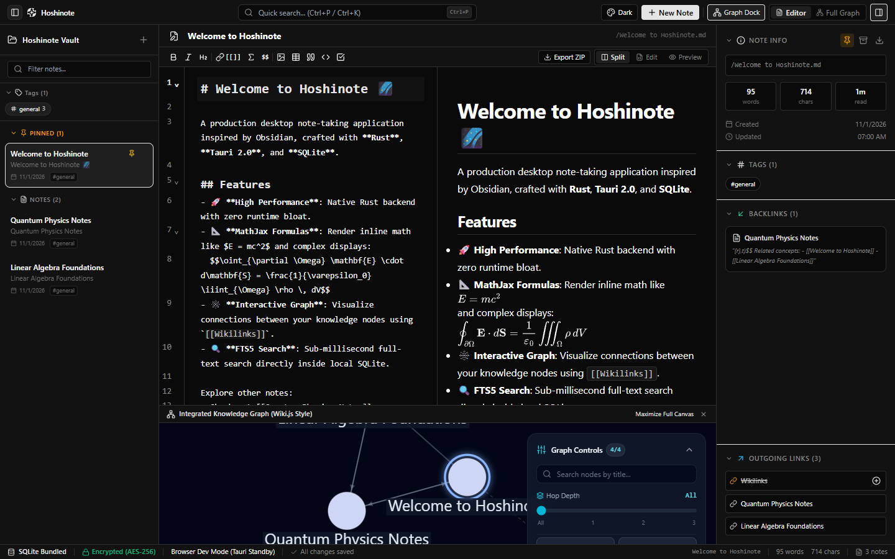
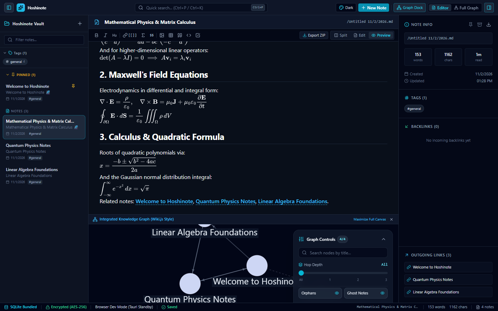
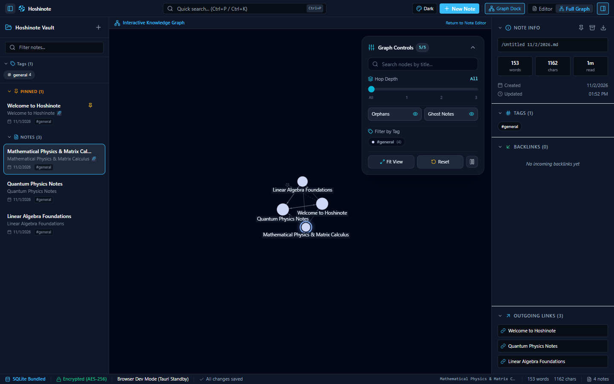

<div align="center">
  
  <h1>Hoshinote 🌌</h1>
  <p><strong>A high-performance, local-first desktop knowledge management application</strong></p>
  <p>Crafted with <strong>Rust</strong>, <strong>Tauri 2.0</strong>, <strong>SQLite</strong>, <strong>React 19</strong>, and <strong>MathJax</strong>.</p>

  [](https://github.com/nmkdeveloper/hoshinote/actions/workflows/ci.yml)
  [](LICENSE)
  [](package.json)
  [](package.json)
  [](src-tauri/Cargo.toml)
</div>

---

## 🌟 Overview

**Hoshinote** is an Obsidian-inspired, distraction-free desktop application tailored for researchers, engineers, and students who write extensively with mathematical formulas, technical markdown, and knowledge graphs.

Unlike traditional heavy Electron-based note apps, Hoshinote leverages **Tauri 2.0** and **Rust** with an embedded in-process **SQLite** database, delivering sub-millisecond query latency, tiny RAM usage, and instant startup times.

---

## ✨ Key Features

- 🚀 **Native Rust & Tauri 2.0 Core**: Minimal resource footprint, native OS windowing, and secure inter-process communication.
- 📐 **Vector SVG MathJax 3 Engine**: Pure scalable vector math rendering for inline (`$E = mc^2$`) and display (`$$\int f(x) dx$$`) equations with zero external CDN dependence.
- 🕸️ **User-Authored Markdown Graphs**: Embed dynamic 2D force-directed interactive diagrams directly into your notes using intuitive Plaintext DSL (`A -> B: label`) or standard `mermaid` codeblocks.
- 📝 **LiveView & Multi-Mode Editing**:
  - **LiveView**: A distraction-free, single-pane Word-like editing surface where formatted typography, MathJax SVGs, tables, checklists, and embedded graphs render in real-time.
  - **Split View**: Synchronized two-column view with CodeMirror 6 and live preview.
  - **Editor & Preview**: Dedicated single-purpose views for concentrated editing or reading.
- 🔗 **Obsidian-Style Wikilinks**: Full support for `[[Target]]`, `[[Target|Alias]]`, `[[Target#Heading]]`, automated dangling link resolution, and real-time backlink querying.
- 🔍 **SQLite FTS5 Full-Text Search**: Sub-millisecond keyword lookup with BM25 relevance ranking, match highlighting, and surrounding context snippets.
- 🔒 **AES-256-GCM Vault Encryption**: Cryptographically secure local vault snapshots using 256-bit AES-GCM with tamper-detection nonces.
- 🎨 **Extensible Theme Engine**: Beautiful out-of-the-box themes including Tokyo Night, Catppuccin Mocha, Gruvbox, Nord, Solarized, Cyberpunk, Obsidian Dark, and Pure Monochrome Dark/Light, with custom theme JSON import/export.
- 🔄 **GitHub Auto-Updater**: Built-in update checker checking GitHub Releases (`nmkdeveloper/hoshinote`), displaying release notes and enabling 1-click installer download.
- 📦 **Zip Archive Export**: Package notes along with their attachments and markdown source into a portable `.zip` bundle.

---

## 📸 Screenshots

| 01. Note Editor & Live Preview | 02. Vector MathJax Rendering | 03. Interactive Embedded Graph |
| :---: | :---: | :---: |
|  |  |  |

---

## ⌨️ Keyboard Shortcuts

| Shortcut | Action |
| :--- | :--- |
| `Ctrl + P` / `Ctrl + O` / `Ctrl + K` | Open Quick Switcher & Global Search |
| `Ctrl + E` | Cycle View Modes (`Split` $\rightarrow$ `LiveView` $\rightarrow$ `Preview` $\rightarrow$ `Edit`) |
| `Ctrl + B` | Toggle Left Sidebar (Notes & Tags) |
| `Ctrl + Shift + B` | Toggle Right Inspector Panel (Backlinks & Metadata) |
| `Ctrl + S` | Force Flush Pending Autosave |

---

## 🚀 Getting Started

### Prerequisites

- **Node.js**: `v20.0.0+` or `v22.0.0+ LTS` (Node 22 LTS recommended)
- **pnpm**: `v12.0.0+`
- **Rust**: `rustc 1.85+` or `1.99+` (stable toolchain)
- **Platform Dependencies**:
  - **Windows**: Visual Studio 2022/2026 C++ Build Tools & WebView2.
  - **Linux**: `libwebkit2gtk-4.1-dev`, `build-essential`, `curl`, `wget`, `file`, `libssl-dev`, `libayatana-appindicator3-dev`, `librsvg2-dev`.
  - **macOS**: Xcode Command Line Tools.

### Installation & Development

```bash
# 1. Clone the repository
git clone git@github.com:nmkdeveloper/hoshinote.git
cd hoshinote

# 2. Install frontend dependencies
pnpm install

# 3. Launch desktop development environment (Vite + Tauri)
pnpm run tauri dev

# Or run frontend in browser dev mode (uses built-in mock database)
pnpm run dev
```

### Running Tests

```bash
# Run Frontend Vitest suite (102 tests)
pnpm test

# Run Opaque-Box E2E test runner (78 tests)
node tests/e2e/runner.js

# Run Rust Backend unit and adversarial stress tests (40 tests)
cargo test --manifest-path src-tauri/Cargo.toml

# Production build check
pnpm run build
```

### Packaging Production Desktop Binaries

```bash
# Build desktop installer for current platform
pnpm run tauri build
```
- **Windows**: Generates NSIS installer (`.exe`) and WiX installer (`.msi`) in `src-tauri/target/release/bundle/`.
- **Linux**: Generates `.deb` package and standalone `.AppImage`.
- **macOS**: Generates `.dmg` installer and `.app` bundle.

---

## 🏗️ Architecture

```
┌────────────────────────────────────────────────────────────────────────┐
│                        Tauri 2.0 Desktop Window                        │
├────────────────────────────────────────────────────────────────────────┤
│ Frontend (React 19 + TypeScript + Vite + Tailwind CSS + CodeMirror 6)  │
│                                                                        │
│ ┌────────────────┐ ┌─────────────────────────────────────────────────┐ │
│ │  Left Sidebar  │ │                   Main Area                     │ │
│ │  - Note List   │ │ ┌───────────────────────┬─────────────────────┐ │ │
│ │  - Search Bar  │ │ │ CodeMirror 6 Editor   │ Rendered Markdown   │ │ │
│ │  - Tags Tree   │ │ │ (Markdown & LaTeX)    │ + MathJax SVG       │ │ │
│ │  - Mascot Logo │ │ └───────────────────────┴─────────────────────┘ │ │
│ └────────────────┘ │ ┌─────────────────────────────────────────────┐ │ │
│                    │ │ Word-like Single Pane LiveView Mode         │ │ │
│                    │ └─────────────────────────────────────────────┘ │ │
│                    │ ┌─────────────────────────────────────────────┐ │ │
│                    │ │ Embedded Graph Blocks (```graph / ```mermaid)│ │ │
│                    │ └─────────────────────────────────────────────┘ │ │
│                    └─────────────────────────────────────────────────┘ │
├───────────────────────────────────┬────────────────────────────────────┤
│ IPC Interface                     │ Tauri invoke commands              │
├───────────────────────────────────┴────────────────────────────────────┤
│ Rust Backend (Tauri 2.0 + rusqlite + aes-gcm)                          │
│                                                                        │
│ ┌───────────────────┐ ┌───────────────────┐ ┌────────────────────────┐ │
│ │ NoteService       │ │ GraphService      │ │ Link & Tag Parser    │ │
│ └─────────┬─────────┘ └─────────┬─────────┘ └───────────┬────────────┘ │
│           └─────────────────────┼───────────────────────┘              │
│                                 ▼                                      │
│ ┌────────────────────────────────────────────────────────────────────┐ │
│ │ SQLite 3 Engine (WAL mode, Foreign Keys ON, FTS5 Virtual Table)    │ │
│ │ - notes, links, tags, note_tags                                    │ │
│ │ - Automated relinking triggers for dangling wikilinks              │ │
│ │ - AES-256-GCM encrypted database snapshot vault                    │ │
│ └────────────────────────────────────────────────────────────────────┘ │
└────────────────────────────────────────────────────────────────────────┘
```

For comprehensive details on internal design, read [ARCHITECTURE.md](ARCHITECTURE.md).

---

## 📄 License

This project is licensed under the [MIT License](LICENSE) - see the LICENSE file for details.
Copyright (c) 2026 **nmkdeveloper** (<nguyenminhkhoi.nmk.dev@gmail.com>).
